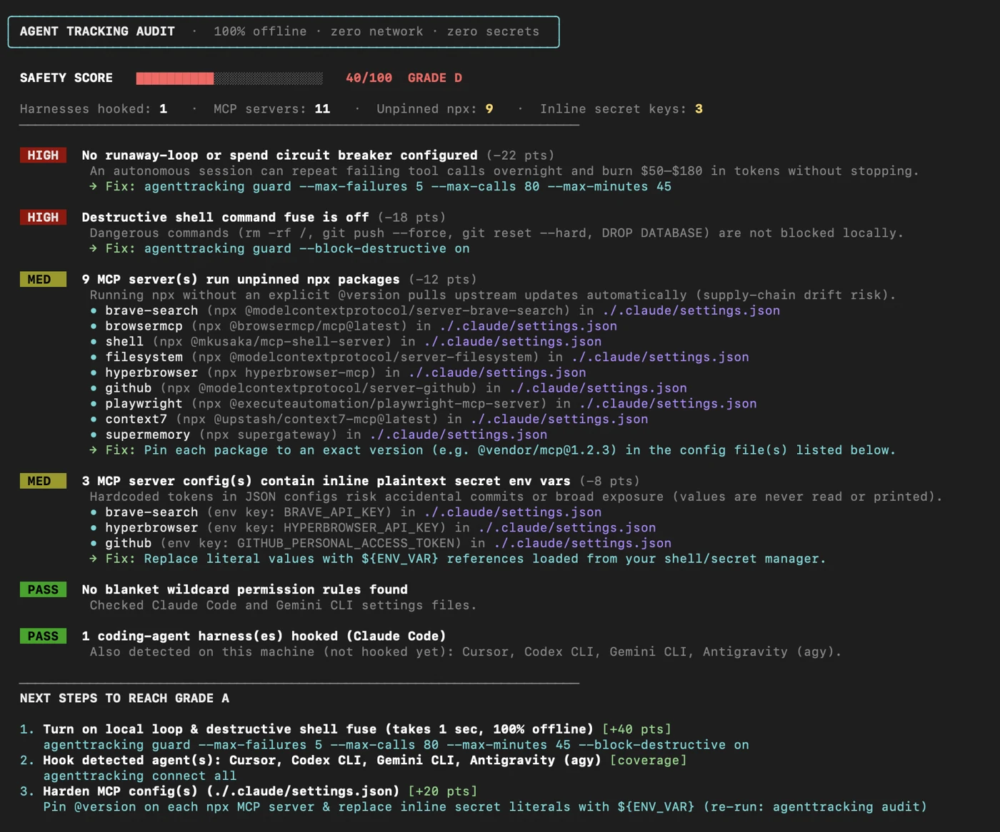
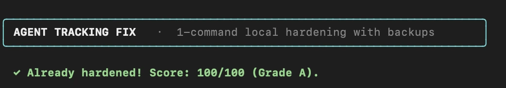
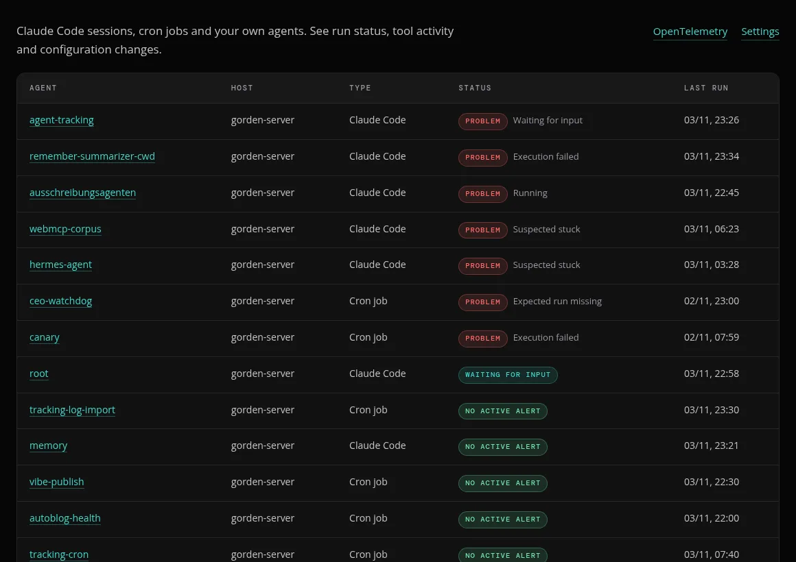

<div align="center">


# Agent Tracking

**Local circuit breaker, MCP security audit, and zero-prompt fleet monitoring for Claude Code, Cursor, Codex CLI, Gemini CLI, Google Antigravity (`agy`), and cron jobs.**

[](https://github.com/shufflethis/agent-tracking/releases/latest)
[](https://github.com/shufflethis/homebrew-tap)
[](LICENSE)
[](#zero-prompt-privacy-contract)
[](https://agenttracking.co/privacy)
[](cli/)

[Website](https://agenttracking.co) · [Live Fleet Demo (no login)](https://agenttracking.co/demo/fleet) · [Documentation](https://agenttracking.co/docs) · [Guides](https://agenttracking.co/guides) · [LinkedIn](https://www.linkedin.com/company/agenttracking/) · [Deutsch](https://agenttracking.co/de)

</div>

```text
╭───────────────────────────────────────────────────────────╮
│   ╱     ╲     AGENT TRACKING                              │
│  <   ●   >    Zero-prompt guardrails & fleet monitor      │
│   ╲     ╱     https://agenttracking.co                    │
╰───────────────────────────────────────────────────────────╯
```

Stop runaway overnight retry loops, catch shadow MCP servers & config drift, and get instant **Telegram, Slack, or Discord** alerts when an agent stalls, waits for approval, or misses a cron schedule — **without ever sending prompts, source code, or secret values off your machine.**

---

## See it in action (100% offline audit → 1-command auto-fix)

<table>
  <tr>
    <td width="50%">
      <strong>1. Spot risks offline (<code>agenttracking audit</code>)</strong><br />
      
    </td>
    <td width="50%">
      <strong>2. Harden in 3 seconds (<code>agenttracking fix</code>)</strong><br />
      
    </td>
  </tr>
</table>

<p align="center">
  
</p>

> Want to click through the dashboard before installing anything? Open the **[interactive live fleet demo](https://agenttracking.co/demo/fleet)** — zero signup, zero data uploaded.

---

## Quickstart (10 seconds · 100% offline)

```sh
# 1. Install via Homebrew (macOS / Linux) and run 100% offline audit (zero network calls)
brew install shufflethis/tap/agenttracking
agenttracking audit

# 2. 1-command auto-fix (arms local guardrails, pins unpinned npx MCPs, externalizes secrets with .bak backups)
agenttracking fix

# Or without Homebrew (SHA-256 verified installer):
curl -fsSL https://agenttracking.co/install.sh | sh -s -- audit

# 3. Connect non-destructive hooks across Claude Code, Cursor, Codex, Gemini & Antigravity
agenttracking connect all

# 4. Upgrade CLI + automatically refresh already-connected hook runtimes
agenttracking upgrade
```

---

## Three deterministic control layers

| Layer | What it stops / detects | Where it runs |
| --- | --- | --- |
| **1. Local Spend & Safety Fuse (`guard`)** | Runaway error loops (`--max-failures 5`), runaway turns (`--max-calls 80`, `--max-minutes 45`), destructive shell commands (`--block-destructive on`) | 100% local in `PreToolUse` (`< 2 ms`, zero network) |
| **2. MCP Security & Config Drift (`audit` + snapshots)** | Unpinned `npx` MCP packages, cleartext `http://` remote MCPs, inline plaintext secret keys, blanket `Bash(*)` permissions, added MCP servers, modified `CLAUDE.md`, first-time tools | Local SHA-256 fingerprinting — zero secret values read |
| **3. Zero-Prompt Fleet & Cron Monitoring (`connect` + `wrap`)** | Silent permission waits, frozen sessions (silence floor), missed cron schedules (`--every 24h`), exit codes, masked stderr (`--tail 20`), OpenTelemetry OTLP traces | EU servers in Germany or AGPL-3.0 self-hosted |

### Supported coding agents & runners

- **Native non-destructive hooks (automatic timestamped backup before every edit):** Claude Code, Cursor, Codex CLI, Gemini CLI, Google Antigravity (`agy`)
- **Cron & CI wrapper:** `agenttracking wrap --name backup --every 24h --tail 20 -- ./backup.sh` (preserves stdout, stderr, and exit code 1:1; locally masks API keys, Bearer tokens, and DB credentials)
- **Custom agents & MCP queries:** `POST /api/agents/otlp` (OTLP/HTTP JSON) and `POST /api/mcp` (`get_fleet_status`)

---

## Zero-prompt privacy contract

- **Sent (only when connected via `login` + `connect`/`wrap`):** event type, tool name, pass/fail status, project folder basename, host label, locally hashed session ID, SHA-256 config fingerprints & MCP counts (for cron: exit code, duration, optional masked stderr).
- **Never sent:** prompts, model responses, tool arguments or outputs, file contents, full filesystem paths, transcripts, or secret values.
- **Retention:** raw agent events expire automatically after 30 days (stderr tails after 7 days).

---

## FAQ & Troubleshooting

<details>
<summary><strong>Why did Agent Tracking ask me to run <code>agenttracking resume</code>?</strong></summary>

Your local circuit breaker (`~/.agenttracking/guard.json`) paused a session after hitting a safety rule:
- a manual `agenttracking pause`,
- consecutive failed tool calls (default `5` when armed via `agenttracking fix`),
- too many tool calls in one autonomous turn (default `80`), or
- a turn runtime cap (default `45 min`).

Run `agenttracking resume` to clear the local pause and counters immediately. To inspect or tune limits for long refactors:

```sh
agenttracking guard                                  # inspect active rules
agenttracking guard --max-calls 200 --max-minutes 120
agenttracking guard --max-minutes off                # turn off one cap
agenttracking guard --reset                          # disable local guard
```

</details>

<details>
<summary><strong>How do I completely uninstall Agent Tracking and restore my original setup?</strong></summary>

Every config edit writes a timestamped backup right next to the original file (`*.agenttracking-backup-*` for hooks, `*.bak-agenttracking-*` for `agenttracking fix`). To remove Agent Tracking cleanly without touching your own hooks:

```sh
# 1. Remove only Agent Tracking hooks (keeps all your own hooks intact)
agenttracking disconnect all
# If you also installed project-scoped hooks, run inside that repo:
agenttracking disconnect all --project

# 2. Only if you used `agenttracking fix` to move MCP secrets to ~/.agenttracking/secrets.env:
#    restore your *.bak-agenttracking-* backups first (and remove any `source ~/.agenttracking/secrets.env` line from ~/.zshrc)

# 3. Uninstall the CLI binary
brew uninstall agenttracking                         # Homebrew
# brew untap shufflethis/tap                         # optional
# or for install.sh: rm -f ~/.local/bin/agenttracking /opt/homebrew/bin/agenttracking /usr/local/bin/agenttracking

# 4. Delete local state, guard rules, spool & cached runtimes
rm -rf ~/.agenttracking
```

If you wrapped any crontab jobs (`agenttracking wrap ... -- <cmd>`), remove the wrapper prefix in `crontab -e`, and optionally revoke the machine token under **Settings** in the web dashboard.

</details>

---

## Pricing (Cloud & Self-Hosted)

| Tier | Price | Includes |
| --- | --- | --- |
| **Free** | **$0 forever** | Up to 5 agents · unlimited offline `audit` & local `guard` · **instant Telegram, Slack, Discord, webhook & email alerts** · daily briefing in your timezone · read-only API & MCP (`get_fleet_status`) |
| **Pro** | **$9/mo** (or $90/yr) | Unlimited agents (up to 500) · MCP & config drift alerts · first-time tool & runaway-loop server signals · OpenTelemetry OTLP ingest · named task checks |
| **Team & Governance** | **From $99/mo** | Shared engineering fleet · shadow-MCP inventory across laptops · centralized guardrail baselines · GDPR-ready EU hosting (Germany) · exportable audit trail · invoice billing |
| **Self-hosted** | **$0 (AGPL-3.0)** | Complete source code: CLI, ingest, dashboard, alerts, guardrails. One Node.js 22 process, one SQLite file. |

---

## Self-hosting

Requirements: Node.js 22.13+ (built-in `node:sqlite`) or Docker, plus a Brevo API key for magic-link sign-in mails.

```sh
git clone https://github.com/shufflethis/agent-tracking.git && cd agent-tracking
cp .env.example .env          # SITE_ORIGIN, UNLOCK_SECRET, BREVO_API_KEY, LEGAL_*
docker compose up -d          # app on 127.0.0.1:3000, data in ./data, cron included
```

## Development

```sh
npm ci
npm test                      # 320+ unit & integration tests (node:test via tsx)
npm run typecheck
npm run dev
```

---

## Bonus free tool: Website AI analytics

Agent Tracking also includes a separate free, cookieless website analytics module at [`/websites`](https://agenttracking.co/websites) (AI referrals, verified crawler logs, WebMCP tool telemetry, and server-confirmed outcome receipts).

## License

AGPL-3.0-only. Copyright (c) 2026 FINAL MASTER LLC and contributors.
